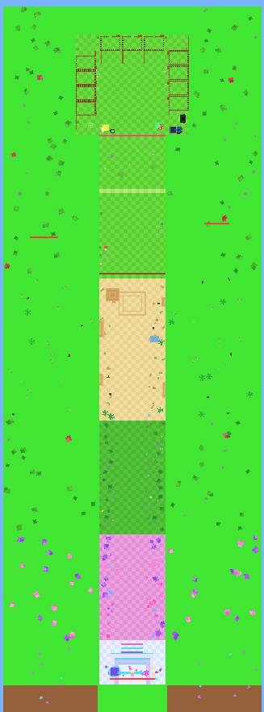
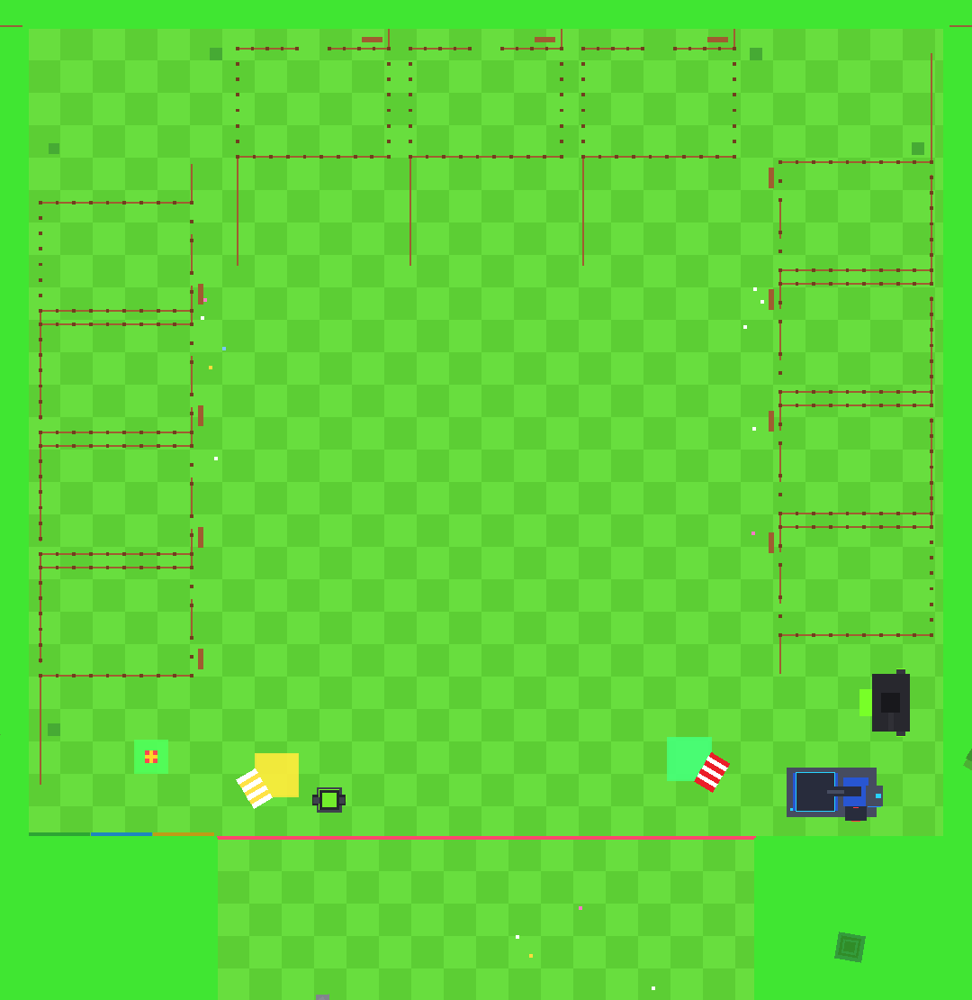

# Steal an Egg — simulator map

A Roblox simulator map built entirely from code: one very long, wide corridor
walled in by tall brown checker cliffs, with a hub of pens and shops at one end
and a glowing portal at the other. Nothing is hand-placed, so the whole map is
reproducible from this repository.



## Layout

The corridor runs along `+Z`, `X = 0` is the centre line, and the ground is at
`Y = 0`. From the closed end to the far end:

| Z range | Area |
| --- | --- |
| -300 → 0 | Hub: pens, Trails Shop, Sell stall and machine, Fuse Machine, leaderboards |
| 0 | Safe Zone line, from the left wall to the right wall |
| 0 → 156 | Start field, bright lime checker grass, kept open |
| 156 → 168 | Pale green stripe across the field |
| 168 → 420 | Egg field, with the Titanic Egg banner at its far end |
| 420 → 840 | Desert: stepped sandstone, pyramid, cacti, oasis, dead trees |
| 840 → 1176 | Forest |
| 1176 → 1488 | Pink and purple fantasy biome |
| 1488 → 1620 | Portal platform and the rainbow endpoint |

The corridor is 200 studs wide and the walls are 62 studs tall, so it reads as
about 8× longer than it is wide, with walls roughly 12 characters high. Props
hug the walls and the centre route stays clear.

## Building it

Everything lives in `src/server/MapBuilder`. `MapBuilder.build(parent, lighting,
terrain)` creates a `Map` model and applies the daylight settings.

### With Rojo

```sh
rojo serve   # then connect from Studio
```

`src/server/BuildMap.server.luau` runs on server start and builds the map unless
a `Map` already sits in `Workspace`. To bake it into the place instead, run this
once in the Studio command bar and save:

```lua
require(game.ServerScriptService.MapBuilder.MapBuilder).build(workspace, game.Lighting, workspace.Terrain)
```

### Without Studio

```sh
lune run scripts/bake.luau                 # -> build/StealAnEggMap.rbxl, .rbxm, topdown.json
python3 scripts/render_topdown.py top 0.42 # -> build/topdown.png
```

`build/StealAnEggMap.rbxl` is a place you can open directly; the `.rbxm` is just
the map model to drag into an existing place.

## What the map contains

- **Shell** — checker floors per biome, checker wall faces with a vivid grass lip
  along their top edge, a grass plateau and tree line above the walls, and a dirt
  island underneath.
- **Safe Zone** — neon boundary line, ground lettering, and an invisible volume
  tagged with a `SafeZone` attribute for gameplay code.
- **Hub** — eleven fenced pens with `PenId`/`Level` attributes and "Upgrade Pen
  Level 1 > Level 2 $50" signs, the striped Trails Shop with its glowing circle
  and dark neon-green machine, the Sell stall with the industrial sell machine
  (screen, teeth, glowing conveyor mouth, toxic-green tank), the Fuse Machine
  with its question-mark chamber and `Fuse Machine 0/3` label, and the TOP CASH /
  TOP SPEED / TOP BLAST leaderboards mounted on the wall.
- **Biomes** — egg zones per section, desert formations, forest, fantasy flora,
  and the rainbow portal with sky beams visible from the hub.



The map is deterministic: `MapBuilder.SEED` drives every prop placement, so two
bakes produce the same world. No UI or HUD is created — this is the physical map
only.
